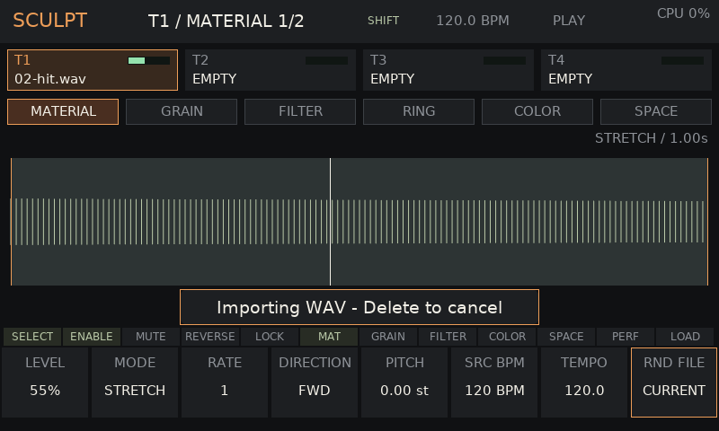
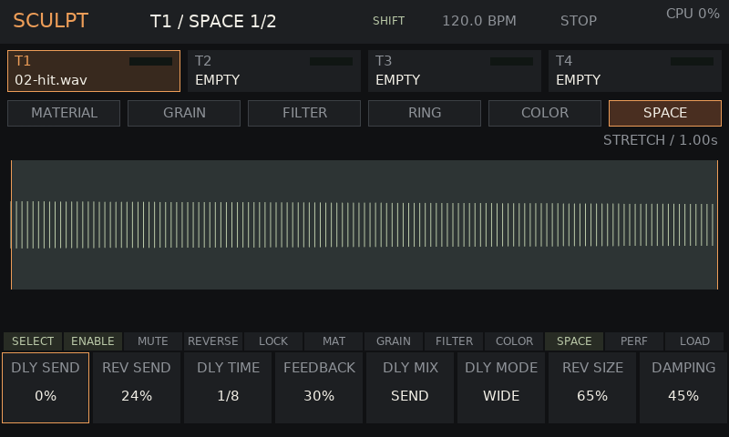
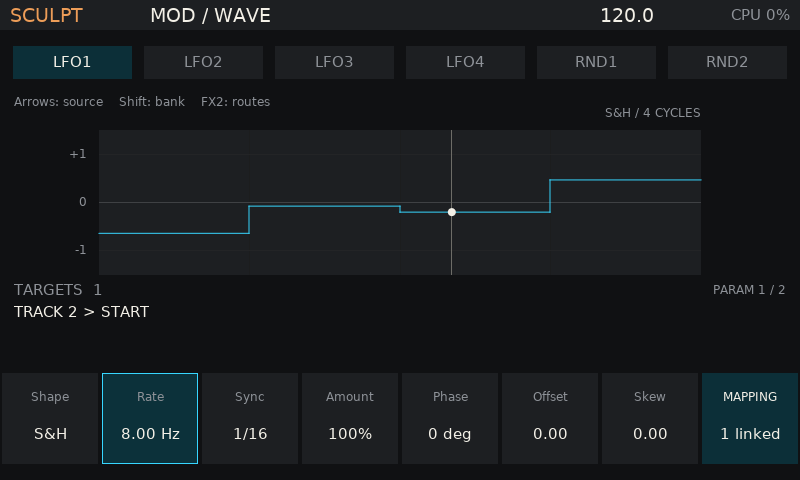
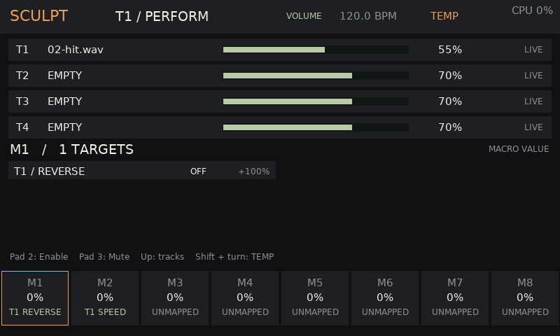

# SCULPT OG

SCULPT OG is an unofficial four-track sampling workstation for the **original Polyend Tracker**. Build ambient layers, techno textures, and live variations by loading WAV loops, setting their source tempo, and shaping them with granular processing, resonators, coloration, and shared delay and reverb.

This repository documents **SC0019 / 0.19**. The [English user manual](manual.md) covers installation and rollback, panel shortcuts, WAV formats, modulation, macros, project management, CPU load, and two example patches.

## Download firmware

[Download firmware bundle (ZIP)](https://github.com/jayveechen1984/sculpt-og-manual/releases/download/v0.19.0/SCULPT-OG-SC0019.zip) · [Download the .ptf](https://github.com/jayveechen1984/sculpt-og-manual/releases/download/v0.19.0/PolyendTrackerSC0019.ptf) · [Release notes](https://github.com/jayveechen1984/sculpt-og-manual/releases/tag/v0.19.0)

The ZIP includes the firmware, installation notes, license notices, and SHA-256 checksum. Install on the **original Tracker OG** using the steps in the manual.

## Workflow

1. Press **Note** to select a track, **Sample Loader** to browse WAVs, and **Insert** to import.
2. Check **SRC BPM** and **MODE** in MATERIAL. Use **RATE** to change speed. Tap **Shift** for loop trimming and launch quantization.
3. Press **Play**. Use **FX1 / FX2** to move through MATERIAL, GRAIN, FILTER, RING, COLOR, and SPACE.
4. Open **Sample Editor** to set up an LFO or a random sequence with a fixed seed. Open **Performance** or **Master** for four track levels and eight macros.

Each track can load up to about 11.89 seconds of stereo WAV audio. Delay and reverb run on two shared buses with independent sends on each track. Four-track CPU load depends on the project and the effects in use.

## Screenshots

Captured in the SC0019 desktop simulator with synthetic test WAVs.

| RING | SPACE |
|---|---|
|  |  |

| Modulation | Performance |
|---|---|
|  |  |

## Credits

- **BULUT / polyend-tracker-lab** is the direct code base. SCULPT reuses LABKIT and its sampling workstation framework. [BULUT upstream](https://github.com/semierendonmez-commits/polyend-tracker-lab)
- **OpenTracker / sandlbn and contributors** provide the hardware and firmware foundation for the original Tracker. [OpenTracker](https://github.com/sandlbn/polyend-tracker-re)
- **Retrack / math0ne** served as an architectural reference for a four-track looper and SD streaming. [Retrack](https://github.com/math0ne/retrack-tracker)
- **Torso Electronics S-4** inspired the sample-first workflow, sound-shaping stages, slow modulation, and performance macros. [Official S-4 user guide](https://docs.torsoelectronics.com/s4/introduction/)

See the manual's [credits and sources](manual.md#credits-and-sources) for more on the upstream DSP, contributors, and licenses. SCULPT OG is an independent community project for the original Tracker.
