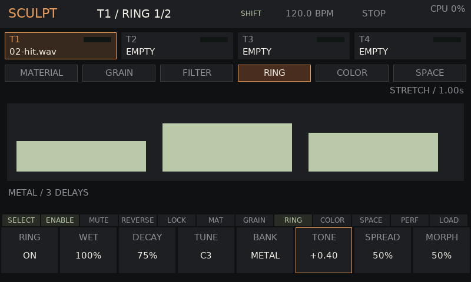

# SCULPT OG

SCULPT OG 是面向 **原版 Polyend Tracker** 的非官方四轨采样工作站。它适合用循环素材制作 ambient、techno ambient 和演出纹理，从导入 WAV、确认原始 BPM、同步或拉伸开始，再调整颗粒、共振、染色与空间效果。

本页展示 **SC0019 / 0.19**。[中文完整操作手册](manual-zh.md) 包含安装与回退、按键表、WAV 格式、调制和 Macro 映射、工程保存、CPU 说明，以及两套制作示例。

## 工作流

1. **Note** 选轨，按 **Sample Loader** 浏览 WAV，**Insert** 导入。
2. 在 **MATERIAL** 确认 SRC BPM 与播放模式。用 RATE 改倍率，短按 Shift 访问裁剪与量化。
3. 按 **Play**，用 **FX1／FX2** 在 MATERIAL、GRAIN、FILTER、RING、COLOR、SPACE 间切换。
4. 用 **Sample Editor** 设置 LFO 或可固定 Seed 的随机序列，用 **Performance／Master** 控制四轨音量和八个宏。

每轨可加载约 11.89 秒的立体声 WAV。Delay 和 Reverb 是两条共享总线，各轨独立控制发送量。SC0019 的四轨 CPU 峰值随工程而变。

## 界面截图

以下截图由 SC0019 的 Mac 模拟器生成，使用合成测试 WAV。

| RING | SPACE |
|---|---|
|  |  |

| 调制 | 演出 |
|---|---|
|  |  |

## 致谢

- **BULUT / polyend-tracker-lab** 是直接代码基础，SCULPT 复用了 LABKIT 和采样工作站框架。 [BULUT 上游项目](https://github.com/semierendonmez-commits/polyend-tracker-lab)
- **OpenTracker / sandlbn 及贡献者** 提供了 Tracker OG 的硬件与固件底层。 [OpenTracker](https://github.com/sandlbn/polyend-tracker-re)
- **Retrack / math0ne** 提供了四轨 Looper 和 SD 流式架构参考。 [Retrack](https://github.com/math0ne/retrack-tracker)
- **Torso Electronics S-4** 提供采样优先、逐段塑形、慢调制和宏控制的工作流灵感。 [S-4 官方指南](https://docs.torsoelectronics.com/s4/introduction/)

上游 DSP、贡献者和许可证说明详见[手册的致谢与来源](manual-zh.md#致谢与来源)。SCULPT OG 是独立社区项目，兼容设备为原版 Tracker OG。
